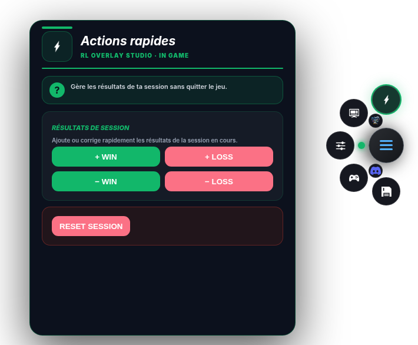
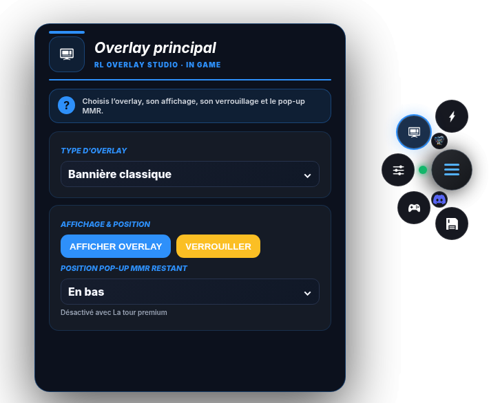
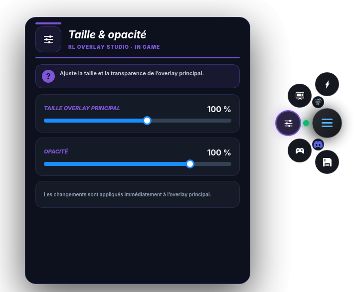
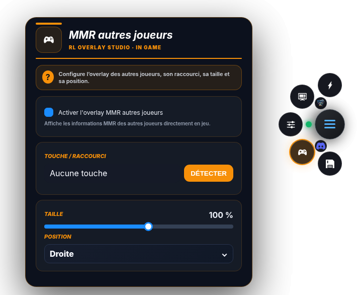
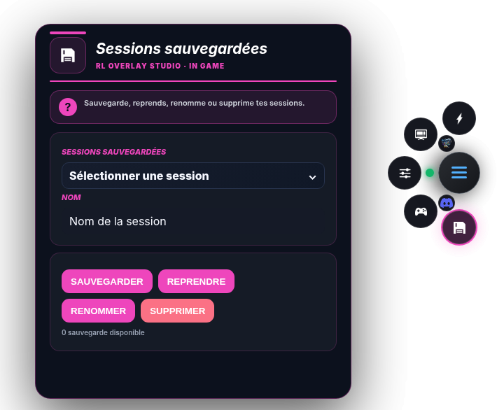
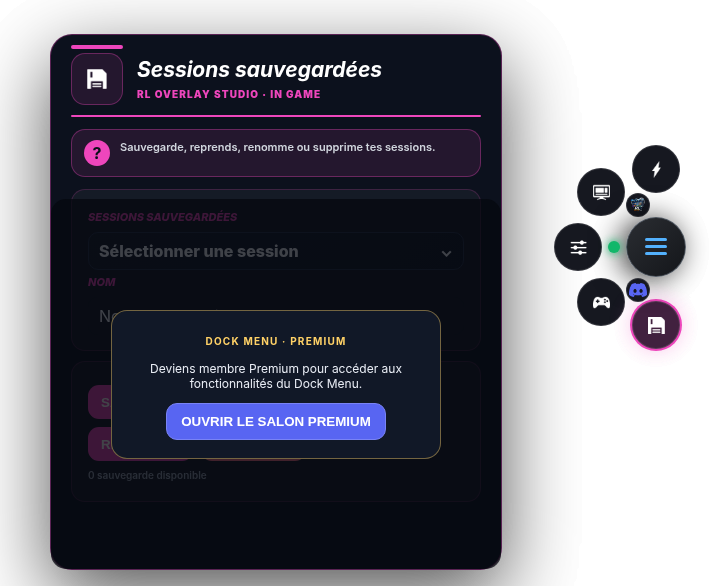
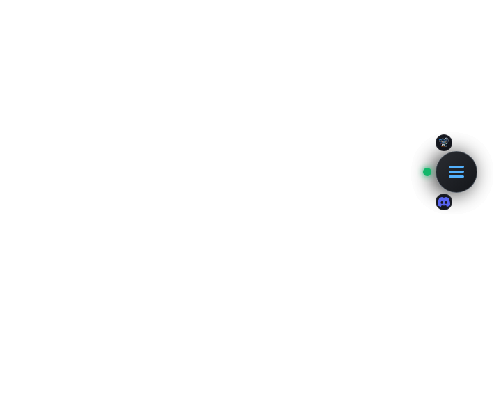
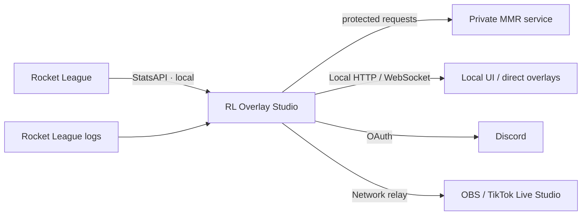

<div align="center">

# RL Overlay Studio

### Rocket League overlays for players, creators & streamers

**Beta 8.46 · Windows · PyQt6 · OBS · TikTok Live Studio · In‑Game · Discord**

[](https://github.com/Lukiseven/RL-Overlay-Studio/releases/latest)


[**⬇️ Latest Release**](https://github.com/Lukiseven/RL-Overlay-Studio/releases/latest) · [**🌐 Gallery (Pages setup required)**](https://lukiseven.github.io/RL-Overlay-Studio/) · [**💬 Discord**](https://discord.gg/Qed73c5kd9)

</div>

<p align="center"><a href="https://lukiseven.github.io/RL-Overlay-Studio/showcase.html"><strong>▶ VIEW AUTHENTIC BETA 8.46 INTERACTIVE DEMOS & ANIMATIONS</strong></a></p>

> **Public audit repository.** The repository exposes the non-sensitive structure and security-relevant portions of RL Overlay Studio so users can inspect how the application behaves. Proprietary MMR/ranking logic, credentials, private endpoints, original UI templates and raw visual/font assets are intentionally excluded. See [`AUDIT_SCOPE.md`](AUDIT_SCOPE.md).

---

## ⚡ What is RL Overlay Studio?

RL Overlay Studio is a Windows companion application for Rocket League players and streamers. It turns game/session information into readable overlays for **OBS**, **TikTok Live Studio** and optional **In‑Game** display.

The product includes:

- session tracking and match-state handling;
- MMR / rank presentation through a protected private service;
- Wins / Losses / Streak presentation;
- multiple streaming overlays;
- Players MMR presentation;
- Showmatch BO3 / BO5 / BO7 / BO9 tools;
- an In‑Game radial Dock;
- Discord authentication / Premium access;
- local HTTP / WebSocket communication;
- automatic update support through GitHub Releases;
- French / English UI.

The application is designed as an **external companion tool** and does not inject code into the Rocket League process.

---

## 🔍 Public source for security review

The folder [`src/`](src/) contains a **sanitized audit copy derived from the Beta 8.46 source**. It is intentionally **not buildable**.

### Included for review

Visitors can inspect, among other things:

- Python imports and dependency usage;
- application bootstrap and PyQt6 structure;
- Windows process/window interaction;
- local file and configuration handling;
- local HTTP / WebSocket architecture;
- StatsAPI client structure;
- Discord OAuth flow structure with identifiers removed;
- logging and diagnostics;
- settings and session persistence;
- update/release logic;
- UI control flow outside protected proprietary modules.

### Deliberately excluded

To protect the project from direct cloning, the public audit source does **not** include:

- MMR acquisition / lookup implementation;
- rank/MMR thresholds and division tables;
- private player identity-resolution logic used by the MMR system;
- API keys, tokens, secrets, Discord IDs and private endpoints;
- private backend request implementation;
- embedded HTML/CSS/JS overlay templates;
- original logos, rank images, PNG/JPG/SVG/ICO assets;
- original font files or font bundle;
- release-protection/signing internals.

Every intentionally removed code block is marked with **`[PUBLIC AUDIT REDACTION]`**. A machine-readable list is also provided in [`redactions_manifest.json`](redactions_manifest.json).

> **Important:** because some proprietary code is redacted, this repository cannot provide a reproducible build or prove byte-for-byte that the public source equals the distributed executable. It provides transparency into the exposed application components and security-relevant behavior. Release hashes are provided separately for integrity verification.

---

# 🎬 Authentic Beta 8.46 Chromium presentations

[**▶ OPEN THE REAL INTERACTIVE GALLERY (GitHub Pages)**](https://lukiseven.github.io/RL-Overlay-Studio/showcase.html)

> **Deployment status (28 October 2026):** The gallery files are committed, but GitHub Pages has not yet been enabled for this repository. The owner must choose **Settings → Pages → Source: GitHub Actions** and then rerun the Pages workflow. [One-time setup instructions](docs/PAGES_SETUP.md).

These presentations use **46 transparent PNG screenshots** and **12 animated WebP sequences**, captured from the original Beta 8.46 HTML/CSS/JS overlay renderer in Chromium. Unlike the previous illustrations, the streamer overlay, Premium Rank Tower, Players MMR and Showmatch visuals are based on genuine application templates. The Desktop UI and radial Dock are faithful HTML transcriptions of the source PyQt6 structure, **not native Windows screenshots**.

**Explore individual features:**

- [Desktop application · five tabs](https://lukiseven.github.io/RL-Overlay-Studio/showcase.html?view=application_ui#presenter)
- [Classic Banner · Top Rank, streak, popups, rank-up/down](https://lukiseven.github.io/RL-Overlay-Studio/showcase.html?view=overlay_banner#presenter)
- [Compact Vertical](https://lukiseven.github.io/RL-Overlay-Studio/showcase.html?view=overlay_vertical#presenter)
- [Compact Horizontal](https://lukiseven.github.io/RL-Overlay-Studio/showcase.html?view=overlay_horizontal#presenter)
- [Premium Rank Tower · live ring animation](https://lukiseven.github.io/RL-Overlay-Studio/showcase.html?view=premium_rank_tower#presenter)
- [Players MMR · placement and player-leave states](https://lukiseven.github.io/RL-Overlay-Studio/showcase.html?view=players_mmr#presenter)
- [Showmatch · BO5/BO7 and completed series](https://lukiseven.github.io/RL-Overlay-Studio/showcase.html?view=showmatch#presenter)
- **In-Game Dock · corrected radial menu (preview below)**

### 🎮 In-Game Dock — compact radial menu

The five main category buttons are arranged evenly along a **78 px semicircular arc** around Menu. The **Discord** and **Show Application** shortcuts sit **inside the arc**, between the Menu button and the five categories, at about **46 px** from Menu. No GIFs: the seven states below are individual static PNG images with transparent backgrounds.

#### Actions


#### Overlay


#### Appearance


#### Players MMR


#### Sessions


#### Premium unavailable


#### Dock closed


*Source-derived Beta 8.46 Chromium presentation; these are not native Windows screenshots. No production implementation or private credentials are included.*


The gallery has functional mode/state selectors, automatic playback, replay, animation on/off and transparent/checkerboard preview backgrounds. It is presentation-only: all sample metrics are fictional; no game connection, private MMR logic, production templates or API credentials are published. **The GitHub Pages loader assembles static media fragments on the client** to avoid oversized GitHub API uploads and missing relative asset paths.

---

# 🌐 High-level architecture



Private service URLs, credentials, IDs and implementation details are deliberately not published.

---

# 🔐 Security & privacy

The public audit copy is intended to make security review easier without publishing the project's proprietary ranking infrastructure.

- No production API key is included.
- No production token or client secret is included.
- No private backend hostname is included.
- Long account/server identifiers used internally are redacted.
- Original visual assets and font files are omitted.
- The source contains explicit markers where protected logic was removed.

For the exact review boundary, read [`AUDIT_SCOPE.md`](AUDIT_SCOPE.md). To report a security issue, read [`SECURITY.md`](SECURITY.md).

---

# ✅ Release integrity — Beta 8.46

Release SHA-256 values are documented in [`RELEASE_VERIFICATION.md`](RELEASE_VERIFICATION.md).

```text
ZIP : fcced4298a0952b109b4e657c82aa1c79c911f9875a43cc7974e862731adb4f6
EXE : c7aaea996bbfafb9fe1c2aa11e2f8cd75a8a4557c7c847cc1dfc2418fb9f7e87
```

These hashes let users verify that the file they downloaded is the same release file referenced by this repository.

---

# 📦 Dependencies

The public dependency manifest is available in [`src/requirements.txt`](src/requirements.txt). The principal runtime technologies are:

- Python
- PyQt6
- PyQt6 WebEngine
- WebSockets
- local HTTP networking
- Discord OAuth
- GitHub Releases

---

# 📄 License / source availability

This repository is **source-available for audit**, not an open-source grant for reuse. The proprietary license and audit-use terms are in [`LICENSE.txt`](LICENSE.txt).

The published reconstructed vector artwork and HTML demos are illustrative presentations only; they are not the original game assets or the full application implementation.

---

<div align="center">

**RL Overlay Studio · Beta 8.46**  
Built for the Rocket League community.

[Latest Release](https://github.com/Lukiseven/RL-Overlay-Studio/releases/latest) · [Discord](https://discord.gg/Qed73c5kd9)

</div>