# RL Overlay Studio

### Rocket League overlays for players, content creators and streamers

**Beta 8.46 · Windows 10/11 · OBS · TikTok Live Studio · In-Game · Discord**

[](https://github.com/Lukiseven/RL-Overlay-Studio/releases/latest)  

**[Download the latest release](https://github.com/Lukiseven/RL-Overlay-Studio/releases/latest)** · **[Join our Discord](https://discord.gg/Qed73c5kd9)** · **[Source audit scope](AUDIT_SCOPE.md)**

RL Overlay Studio is an external Windows companion for Rocket League. It tracks session activity and displays rank/MMR, wins, losses, streaks and match information through customizable overlays. Stream to OBS or TikTok Live Studio, or use optional In-Game components. The application does **not** inject code into Rocket League.

> **About these screenshots:** The streamer overlays, Players MMR and Showmatch are flattened Chromium renders of the original Beta 8.46 HTML/CSS/JavaScript templates. Desktop application pages and Dock panels are accurate **HTML presentations reconstructed from the PyQt6 source**, not direct Windows application captures. The corrected Dock geometry follows the original uncompiled Beta 8.46 source. Player names, scores, MMR and ranks are sample values. All screenshots are static, with no live API requests.

---

## 01 · Application overview

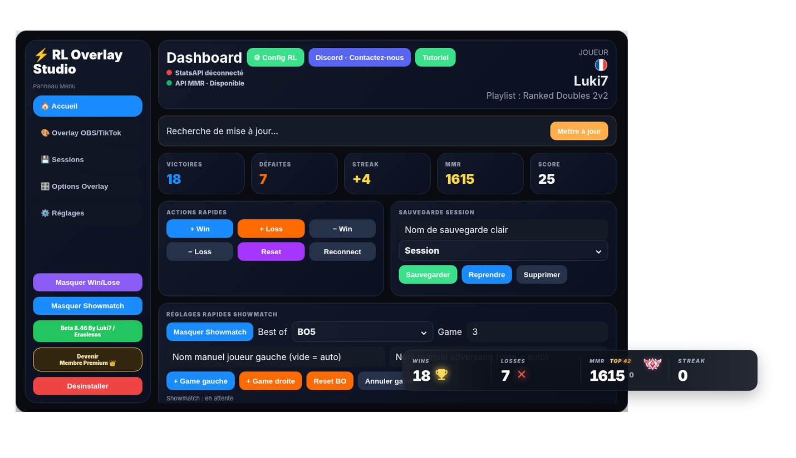

### Dashboard

Session wins/losses, current streak, rank and MMR, match status, connection indicators and quick actions.

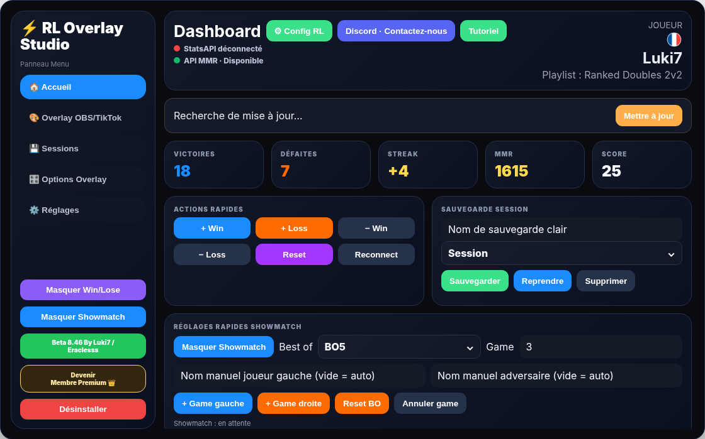

### Application pages and configuration

The desktop interface includes OBS/TikTok Live Studio controls, session management, overlay options and diagnostics. The source screenshots preserve the layout and controls represented in the Beta 8.46 application.

**OBS and TikTok Live Studio configuration**

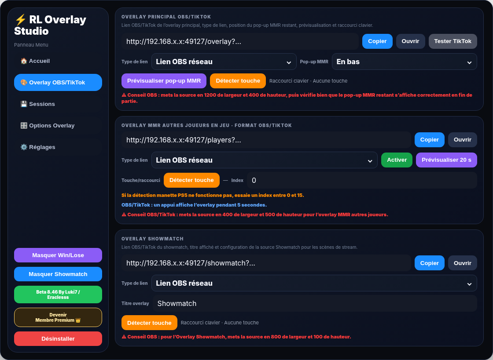

**Session management and saved statistics**

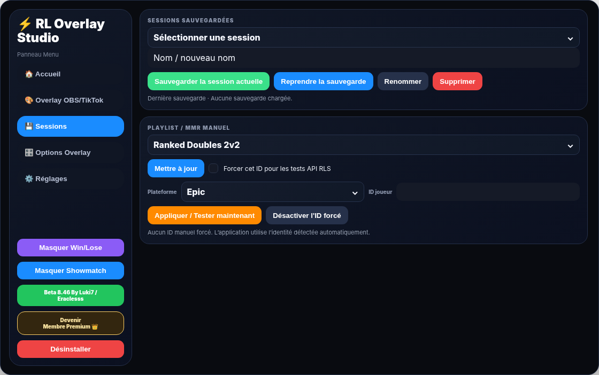

**Overlay settings and customization**

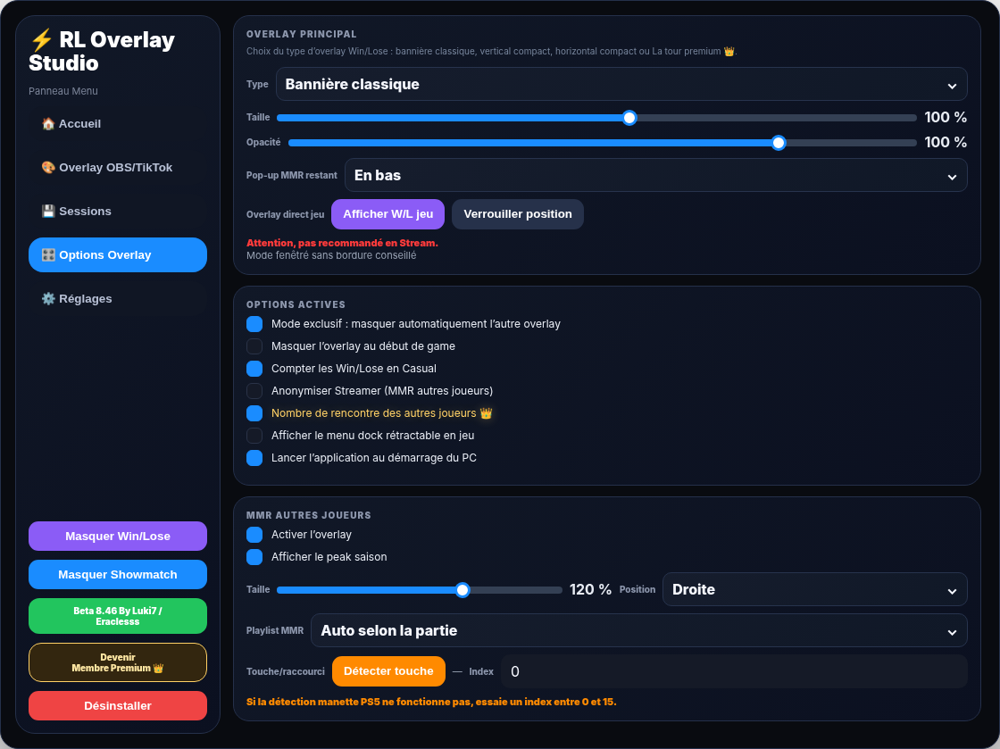

**Application settings and diagnostics**

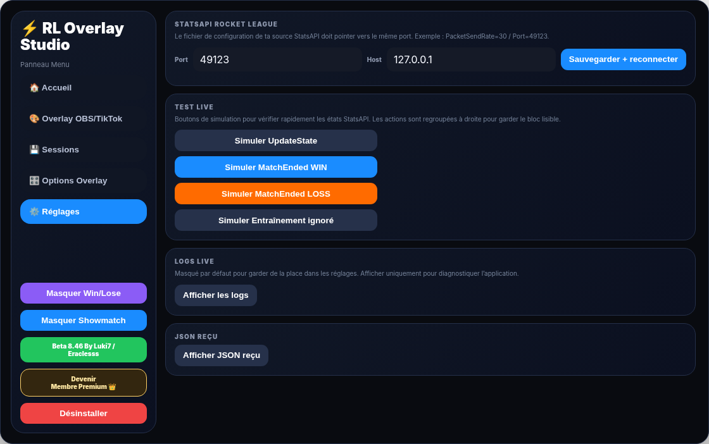

---

## 02 · Streaming overlays

Each layout targets a different on-stream arrangement while presenting the Rocket League session. Compact layouts and the Rank Tower are Premium presentations.

### Classic Banner default view


### Compact Vertical premium layout

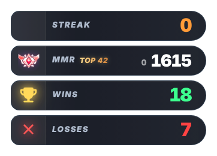

### Compact Horizontal premium layout

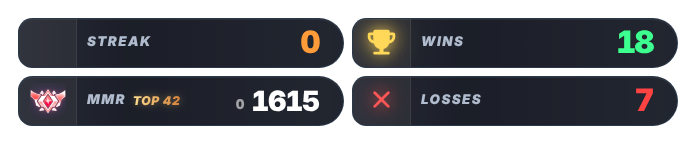

### Premium Rank Tower

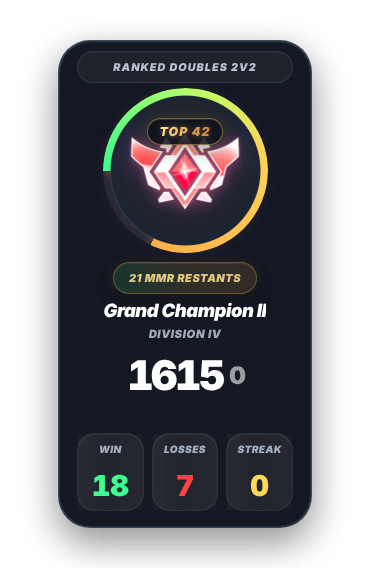

**Supported information:** current playlist and rank/division, MMR, wins, losses, streaks, Top Rank (when applicable) and match events.

---

## 03 · Classic Banner — states and effects

The banner can represent match events, rank changes, Top Rank levels and MMR pop-ups. The following images are **individual static captures of demonstration states**, not animated playback. Effects that depend on timing may look identical in a still frame; for example, Freeplay/private context or Rank Up can change underlying behavior without a permanently different visual.

### Session & streaks

| | |
| :---: | :---: |
|  |  |
| 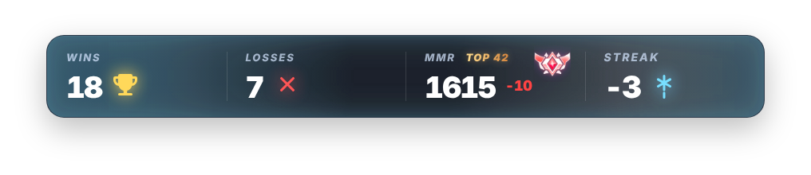 |  |
| 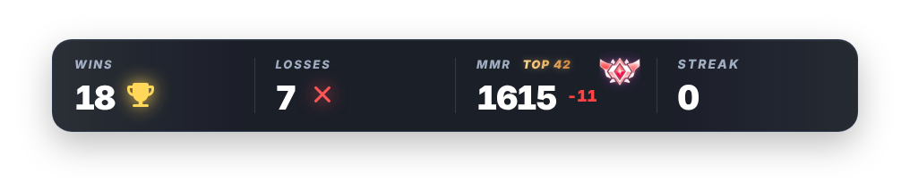 | 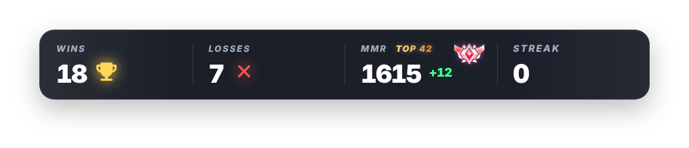 |
|  |  |

### Top Rank & rank availability

- **Top 1–5:** red.
- **Top 6–100:** gold.
- **Top 101–200:** silver.
- **Outside Top 200:** Top Rank hidden.

| | |
| :---: | :---: |
| 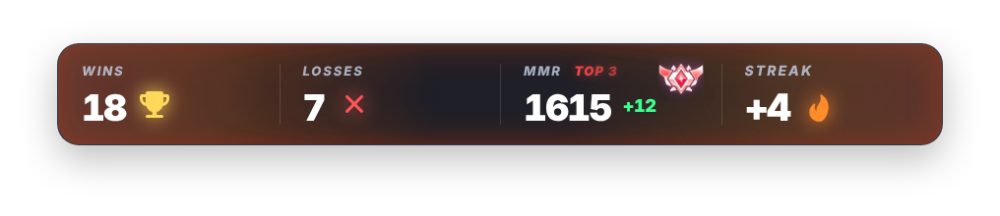 | 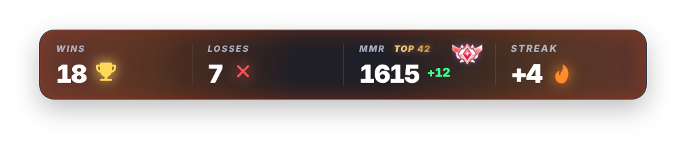 |
| 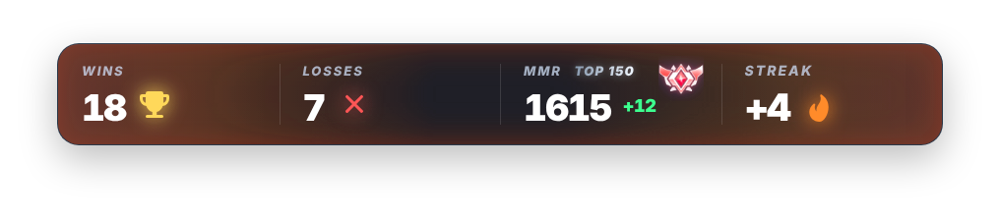 | 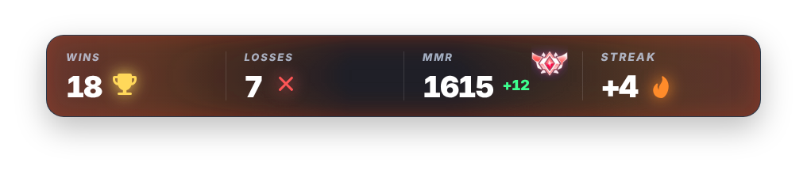 |
| 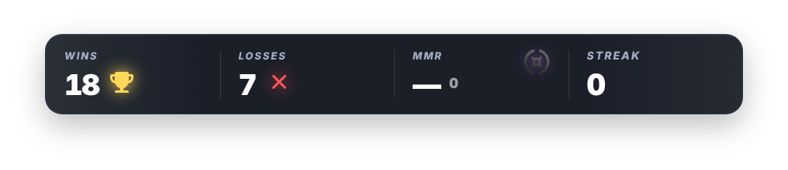 | 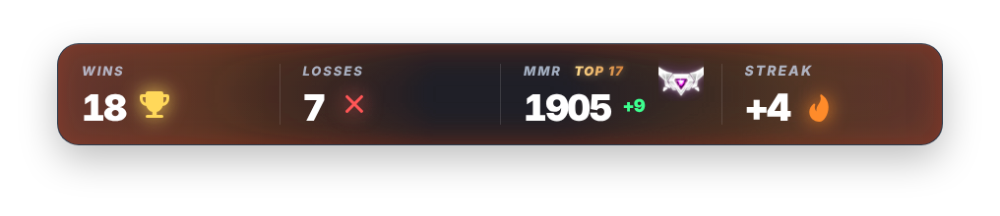 |

### Positionable MMR pop-ups

| | |
| :---: | :---: |
| 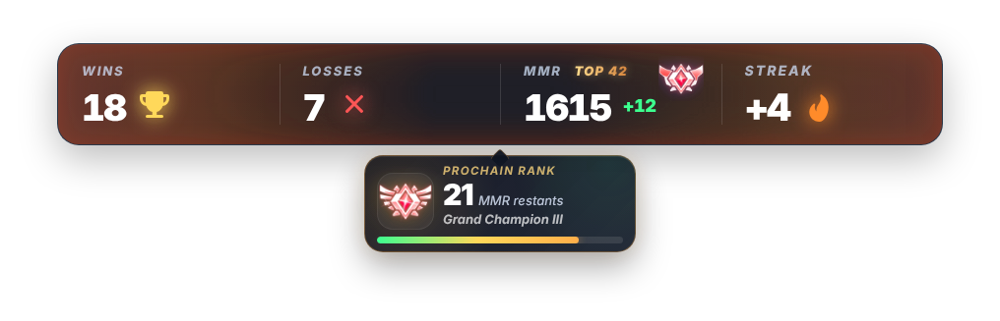 | 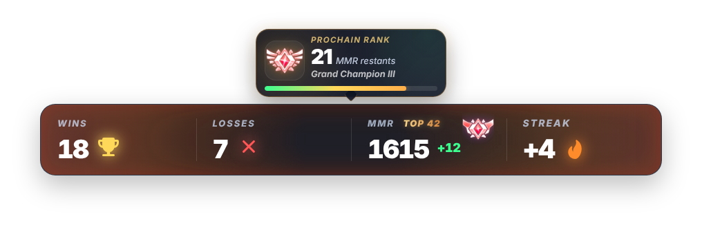 |
| 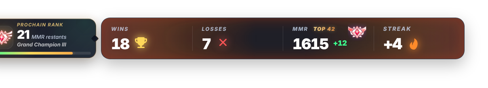 | 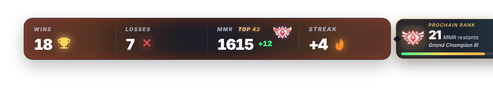 |

**These are different presentation states of the original overlay renderer**, displayed without exposing its proprietary HTML templates or protected MMR/ranking implementation.

---

## 04 · Players MMR (In-Game)

Displays the other players' platform markers, ranks, divisions and available MMR information, with positioning and player-departure states.

### Players MMR — right-aligned

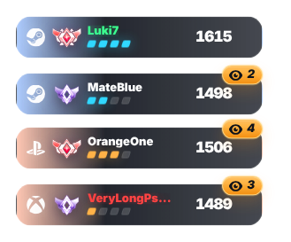

### Players MMR — left-aligned

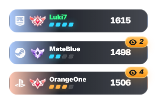

### Players MMR — player departed

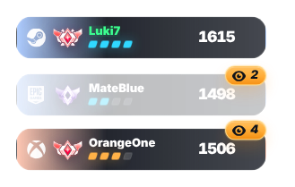

---

## 05 · Showmatch — competitive series

Showmatch presentation supports **BO3, BO5, BO7 and BO9**, series scores, current game and completed-series winner states. The screenshots below show selected source-rendered states.

| | |
| :---: | :---: |
| 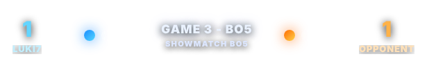 | 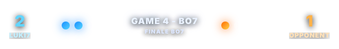 |
| 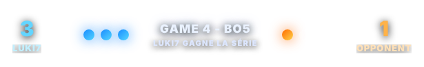 | 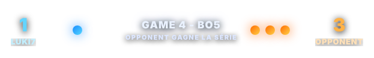 |

---

## 06 · In-Game Dock — original Beta 8.46 geometry

The following **seven static presentations** retain the corrected radial-button positions from the uncompiled Beta 8.46 `InGameQuickMenu` source rather than approximated semicircle positions.

- **Main Menu:** 60 × 60 px.
- **Five categories:** 48 × 48 px, radius 108 px; angles **118°, 149°, 180°, 211° and 242°**.
- **Show Application:** 36 × 36 px, vertically aligned above Menu, with an 8 px gap.
- **Discord:** 36 × 36 px, vertically aligned below Menu, with an 8 px gap.
- **Category panel:** 452 × 536 px, with an 18 px horizontal gap to the nearest radial category button.

| | |
| :---: | :---: |
|  |  |
|  |  |
|  |  |

**Dock closed**


The category views are **Actions, Overlay, Appearance, Players MMR and Sessions**, plus the Premium-unavailable and collapsed presentations. No animated GIF, interactive demo or external gallery is required to view them.

---

## 07 · Capabilities

- **Session tracking:** wins, losses, streaks, ranked and selected casual handling, match-state detection, saved sessions.
- **Overlays:** Classic Banner, Compact Vertical, Compact Horizontal, Premium Rank Tower, Players MMR and Showmatch.
- **Streaming:** OBS/TikTok Browser Sources and network relay support.
- **In-Game:** optional radial Dock, status displays, configurable visibility and controls.
- **Access:** Discord authentication and Premium feature gating.
- **Localization:** French and English.
- **Updates & diagnostics:** GitHub release checks, local logs and connection status indicators.

---

## 08 · Technical architecture

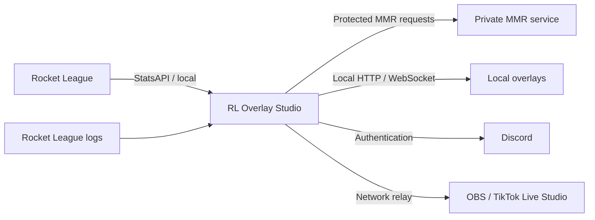

The app is built with **Python, PyQt6, PyQt6 WebEngine, HTML/CSS/JavaScript, local HTTP/WebSockets, and Discord OAuth**.

### Public audit source

This repository provides a **sanitized, non-buildable security-review copy derived from Beta 8.46** in [`src/`](src/). It exposes the application's high-level structure, local networking, diagnostics, configuration, authentication flow and update architecture while withholding proprietary ranking/MMR internals, private endpoints, keys and production artwork.

- [Audit scope](AUDIT_SCOPE.md)
- [Redactions and exclusions](REDACTIONS.md)
- [Third-party dependencies](THIRD_PARTY_DEPENDENCIES.md)
- [Security policy](SECURITY.md)
- [Audit-use license](LICENSE.txt)

The published screenshots are flattened, demonstration-only presentations. Their inclusion does not provide complete or reproducible production source code.

---

## 09 · Beta 8.46 release integrity

[Release verification instructions](RELEASE_VERIFICATION.md)

```text
ZIP SHA-256: fcced4298a0952b109b4e657c82aa1c79c911f9875a43cc7974e862731adb4f6
EXE SHA-256: c7aaea996bbfafb9fe1c2aa11e2f8cd75a8a4557c7c847cc1dfc2418fb9f7e87
```

---

**RL Overlay Studio · Beta 8.46** — Built for the Rocket League community.

[Latest release](https://github.com/Lukiseven/RL-Overlay-Studio/releases/latest) · [Discord](https://discord.gg/Qed73c5kd9)
