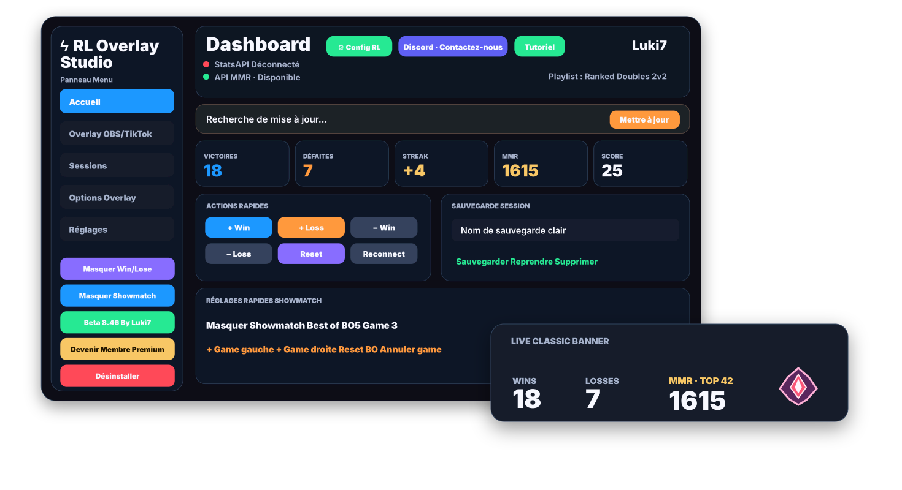
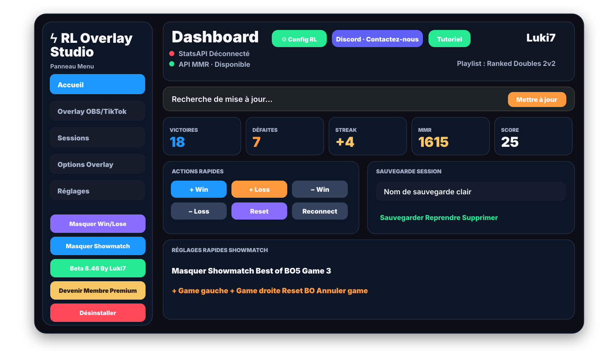
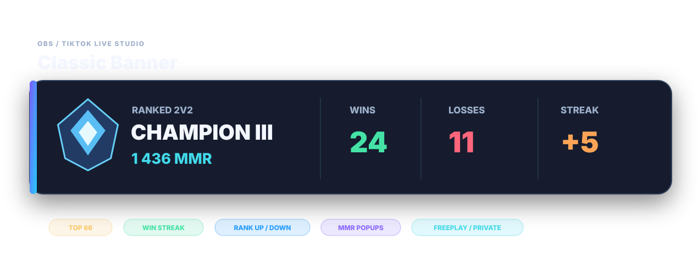
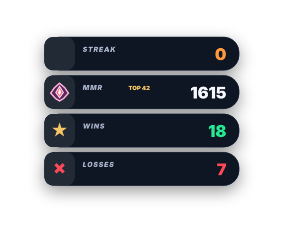
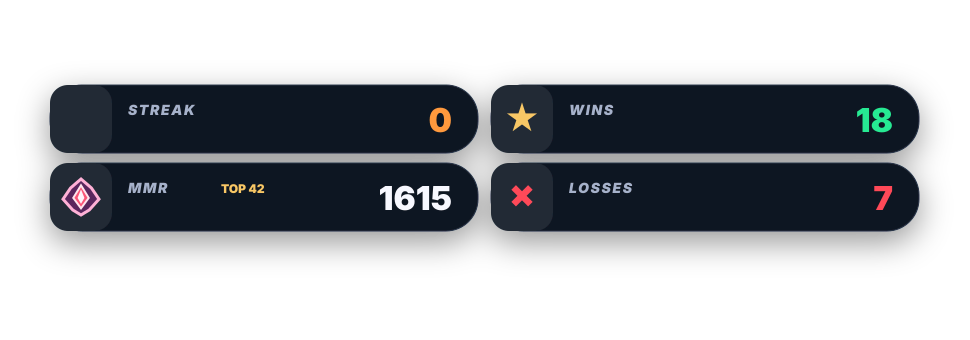
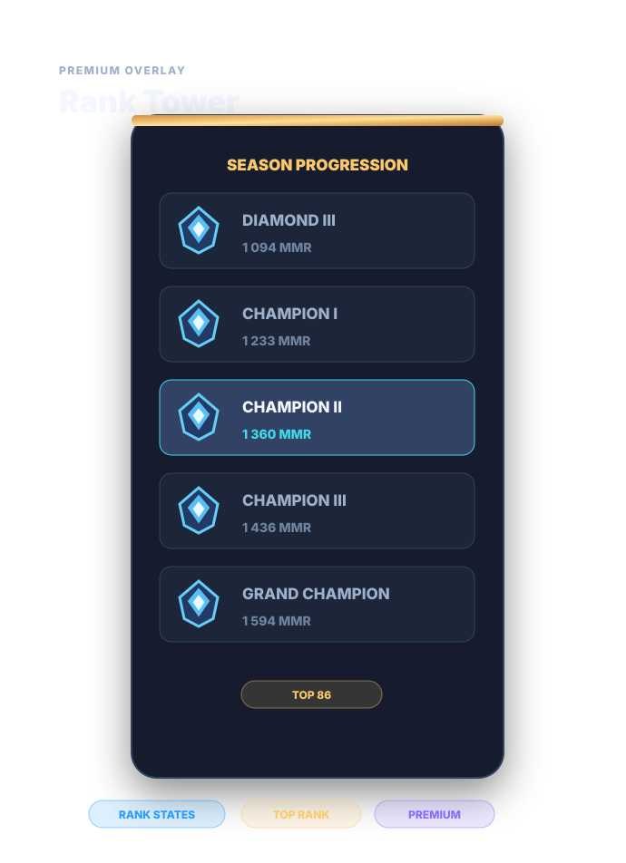
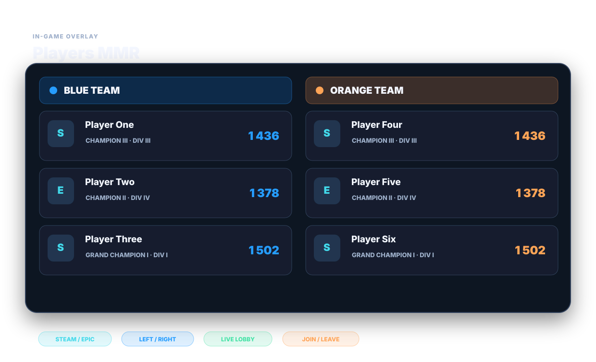
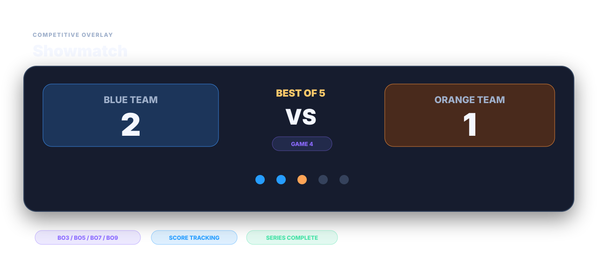
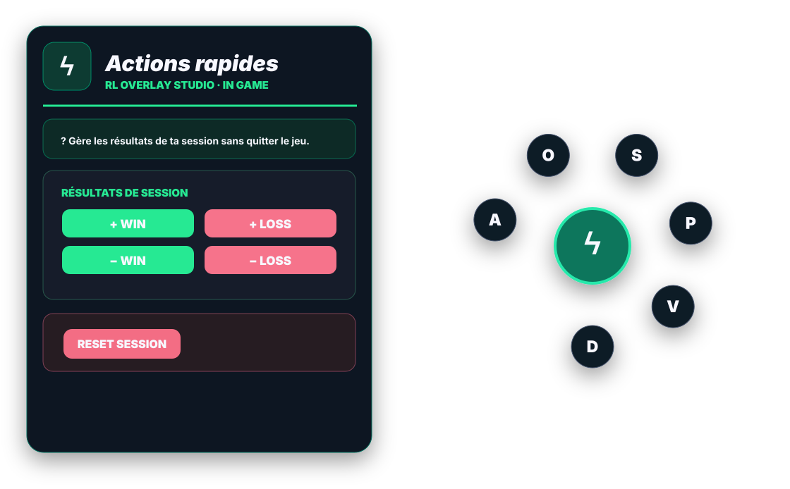
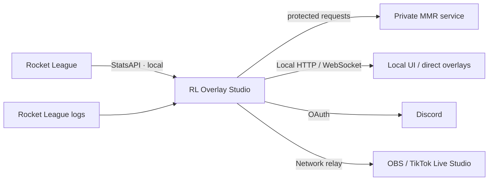

<div align="center">

# RL Overlay Studio

### Rocket League overlays for players, creators & streamers

**Beta 8.46 · Windows · PyQt6 · OBS · TikTok Live Studio · In‑Game · Discord**

[](https://github.com/Lukiseven/RL-Overlay-Studio/releases/latest)


[**⬇️ Latest Release**](https://github.com/Lukiseven/RL-Overlay-Studio/releases/latest) · [**🌐 Live Demos**](https://lukiseven.github.io/RL-Overlay-Studio/) · [**💬 Discord**](https://discord.gg/Qed73c5kd9)

</div>

<p align="center">
  
</p>

> **Public audit repository.** The repository exposes the non-sensitive structure and security-relevant portions of RL Overlay Studio so users can inspect how the application behaves. Proprietary MMR/ranking logic, credentials, private endpoints, original UI templates and raw visual/font assets are intentionally excluded. See [`AUDIT_SCOPE.md`](AUDIT_SCOPE.md).

---

## ⚡ What is RL Overlay Studio?

RL Overlay Studio is a Windows companion application for Rocket League players and streamers. It turns game/session information into readable overlays for **OBS**, **TikTok Live Studio** and optional **In‑Game** display.

The product includes:

- session tracking and match-state handling;
- MMR / rank presentation through a protected private service;
- Wins / Losses / Streak presentation;
- multiple streaming overlays;
- Players MMR presentation;
- Showmatch BO3 / BO5 / BO7 / BO9 tools;
- an In‑Game radial Dock;
- Discord authentication / Premium access;
- local HTTP / WebSocket communication;
- automatic update support through GitHub Releases;
- French / English UI.

The application is designed as an **external companion tool** and does not inject code into the Rocket League process.

---

## 🔍 Public source for security review

The folder [`src/`](src/) contains a **sanitized audit copy derived from the Beta 8.46 source**. It is intentionally **not buildable**.

### Included for review

Visitors can inspect, among other things:

- Python imports and dependency usage;
- application bootstrap and PyQt6 structure;
- Windows process/window interaction;
- local file and configuration handling;
- local HTTP / WebSocket architecture;
- StatsAPI client structure;
- Discord OAuth flow structure with identifiers removed;
- logging and diagnostics;
- settings and session persistence;
- update/release logic;
- UI control flow outside protected proprietary modules.

### Deliberately excluded

To protect the project from direct cloning, the public audit source does **not** include:

- MMR acquisition / lookup implementation;
- rank/MMR thresholds and division tables;
- private player identity-resolution logic used by the MMR system;
- API keys, tokens, secrets, Discord IDs and private endpoints;
- private backend request implementation;
- embedded HTML/CSS/JS overlay templates;
- original logos, rank images, PNG/JPG/SVG/ICO assets;
- original font files or font bundle;
- release-protection/signing internals.

Every intentionally removed code block is marked with **`[PUBLIC AUDIT REDACTION]`**. A machine-readable list is also provided in [`redactions_manifest.json`](redactions_manifest.json).

> **Important:** because some proprietary code is redacted, this repository cannot provide a reproducible build or prove byte-for-byte that the public source equals the distributed executable. It provides transparency into the exposed application components and security-relevant behavior. Release hashes are provided separately for integrity verification.

---

# 🎨 Recreated transparent previews and interactive demos

The images below are **new, original vector illustrations** reconstructed from the documented features and layout of Beta 8.46. They are not background-removed screenshots or pixel-exact copies of the application. Each SVG has a **transparent canvas** and the UI panels themselves are drawn as separate elements. Click a preview to explore **interactive, state-switchable HTML demonstrations** on GitHub Pages.

> The demos use **example data only** and recreate UI states in standalone HTML. They do not connect to Rocket League, the private MMR implementation or the production backend; they do not contain API credentials, private endpoints, the original font bundle, original image assets or production overlay templates.

<p align="center">
  <a href="https://lukiseven.github.io/RL-Overlay-Studio/"><b>🌐 OPEN THE LIVE DEMO GALLERY</b></a>
</p>

## 🖥️ Main application

<p align="center">
  <a href="https://lukiseven.github.io/RL-Overlay-Studio/demo.html?view=application_ui">
    
  </a><br>
  <sub>▶ <a href="https://lukiseven.github.io/RL-Overlay-Studio/demo.html?view=application_ui"><b>Open Live HTML Demo</b></a></sub>
</p>

## 🎨 Classic Banner

<p align="center">
  <a href="https://lukiseven.github.io/RL-Overlay-Studio/demo.html?view=overlay_banner">
    
  </a><br>
  <sub>▶ <a href="https://lukiseven.github.io/RL-Overlay-Studio/demo.html?view=overlay_banner"><b>Open Live HTML Demo</b></a></sub>
</p>

## Vertical Compact

<p align="center">
  <a href="https://lukiseven.github.io/RL-Overlay-Studio/demo.html?view=overlay_vertical">
    
  </a><br>
  <sub>▶ <a href="https://lukiseven.github.io/RL-Overlay-Studio/demo.html?view=overlay_vertical"><b>Open Live HTML Demo</b></a></sub>
</p>

## Horizontal Compact

<p align="center">
  <a href="https://lukiseven.github.io/RL-Overlay-Studio/demo.html?view=overlay_horizontal">
    
  </a><br>
  <sub>▶ <a href="https://lukiseven.github.io/RL-Overlay-Studio/demo.html?view=overlay_horizontal"><b>Open Live HTML Demo</b></a></sub>
</p>

## 👑 Premium Rank Tower

<p align="center">
  <a href="https://lukiseven.github.io/RL-Overlay-Studio/demo.html?view=premium_rank_tower">
    
  </a><br>
  <sub>▶ <a href="https://lukiseven.github.io/RL-Overlay-Studio/demo.html?view=premium_rank_tower"><b>Open Live HTML Demo</b></a></sub>
</p>

## 👥 Players MMR

<p align="center">
  <a href="https://lukiseven.github.io/RL-Overlay-Studio/demo.html?view=players_mmr">
    
  </a><br>
  <sub>▶ <a href="https://lukiseven.github.io/RL-Overlay-Studio/demo.html?view=players_mmr"><b>Open Live HTML Demo</b></a></sub>
</p>

## ⚔️ Showmatch

<p align="center">
  <a href="https://lukiseven.github.io/RL-Overlay-Studio/demo.html?view=showmatch">
    
  </a><br>
  <sub>▶ <a href="https://lukiseven.github.io/RL-Overlay-Studio/demo.html?view=showmatch"><b>Open Live HTML Demo</b></a></sub>
</p>

## 🎮 In‑Game Dock

<p align="center">
  <a href="https://lukiseven.github.io/RL-Overlay-Studio/demo.html?view=ingame_dock">
    
  </a><br>
  <sub>▶ <a href="https://lukiseven.github.io/RL-Overlay-Studio/demo.html?view=ingame_dock"><b>Open Live HTML Demo</b></a></sub>
</p>

---

## 🧩 States represented in the interactive demos

The gallery lets you switch through the Beta 8.46 presentation features instead of only watching a static image:

- **Stream overlays:** Classic Banner, Vertical Compact, Horizontal Compact and Premium Rank Tower.
- **Rank/MMR states:** rank up / rank down, unranked/unknown MMR, Supersonic Legend, Top 1–5 (red), Top 6–100 (gold), Top 101–200 (silver), Top Rank hidden, and positionable MMR popup examples.
- **Match status:** win streak / loss streak, Freeplay, private match and direct In-Game contexts.
- **Players MMR:** Blue/Orange teams, platform hints, rank/division/MMR, left/right placement, player leaving and overlay hidden.
- **Showmatch:** BO3 / BO5 / BO7 / BO9, match scores and series winner states.
- **In-Game Dock:** expanded/collapsed, Premium on/off, Actions / Overlay / Appearance / Players / Sessions sections; retraction is off by default.
- **Desktop app:** Dashboard, OBS/TikTok overlays, Sessions, Overlay Options and Settings; status/diagnostics, GitHub update flow and Discord connection are summarized.

All on-page metrics, ranks, sample names, score values and interactions are **fictional demonstrations**, not live game data. Recreated imagery may simplify the look of the production UI.

---

# 🌐 High-level architecture



Private service URLs, credentials, IDs and implementation details are deliberately not published.

---

# 🔐 Security & privacy

The public audit copy is intended to make security review easier without publishing the project's proprietary ranking infrastructure.

- No production API key is included.
- No production token or client secret is included.
- No private backend hostname is included.
- Long account/server identifiers used internally are redacted.
- Original visual assets and font files are omitted.
- The source contains explicit markers where protected logic was removed.

For the exact review boundary, read [`AUDIT_SCOPE.md`](AUDIT_SCOPE.md). To report a security issue, read [`SECURITY.md`](SECURITY.md).

---

# ✅ Release integrity — Beta 8.46

Release SHA-256 values are documented in [`RELEASE_VERIFICATION.md`](RELEASE_VERIFICATION.md).

```text
ZIP : fcced4298a0952b109b4e657c82aa1c79c911f9875a43cc7974e862731adb4f6
EXE : c7aaea996bbfafb9fe1c2aa11e2f8cd75a8a4557c7c847cc1dfc2418fb9f7e87
```

These hashes let users verify that the file they downloaded is the same release file referenced by this repository.

---

# 📦 Dependencies

The public dependency manifest is available in [`src/requirements.txt`](src/requirements.txt). The principal runtime technologies are:

- Python
- PyQt6
- PyQt6 WebEngine
- WebSockets
- local HTTP networking
- Discord OAuth
- GitHub Releases

---

# 📄 License / source availability

This repository is **source-available for audit**, not an open-source grant for reuse. The proprietary license and audit-use terms are in [`LICENSE.txt`](LICENSE.txt).

The published reconstructed vector artwork and HTML demos are illustrative presentations only; they are not the original game assets or the full application implementation.

---

<div align="center">

**RL Overlay Studio · Beta 8.46**  
Built for the Rocket League community.

[Latest Release](https://github.com/Lukiseven/RL-Overlay-Studio/releases/latest) · [Discord](https://discord.gg/Qed73c5kd9)

</div>